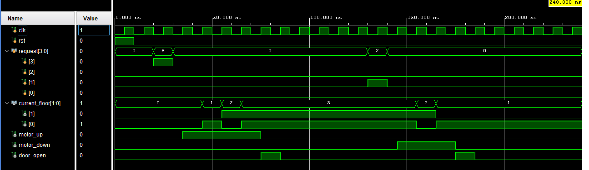

# Elevator-Controller-FSM
Design and simulation of a four-floor elevator controller using Finite State Machine(FSM) architecture in Verilog HDL and Xilinx Vivado.

## Simulation Results

The waveform below shows the behavior of the four-floor
elevator controller during behavioral simulation in Vivado.

